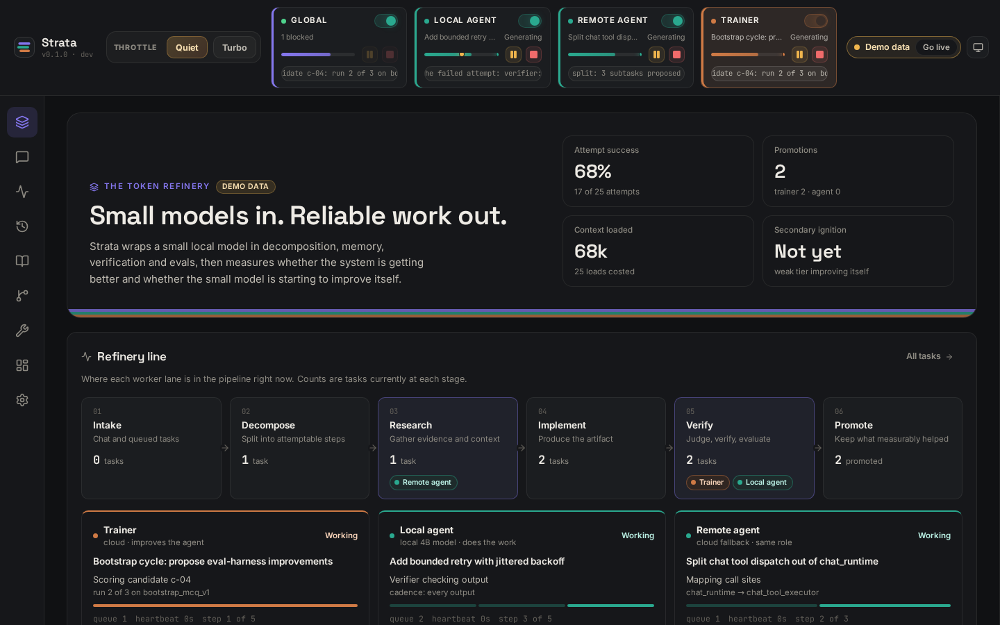
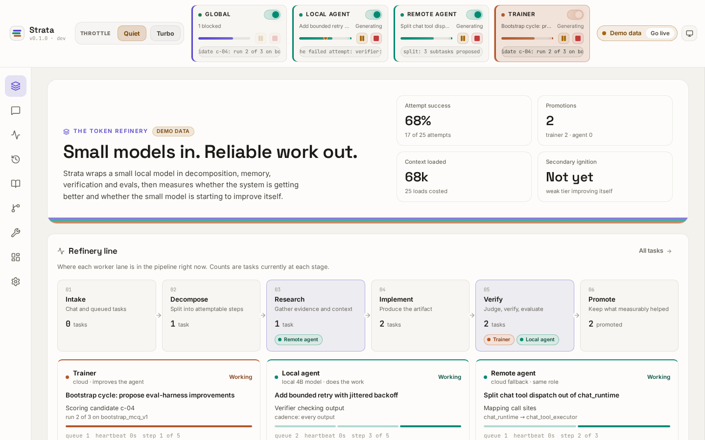
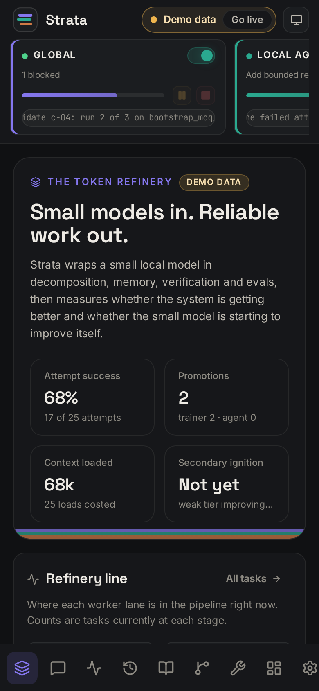
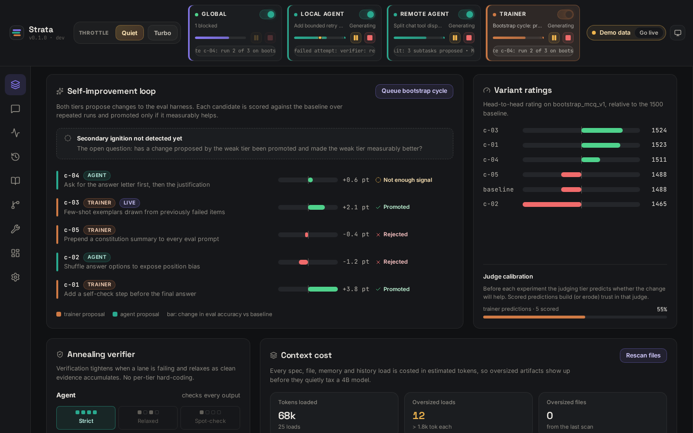
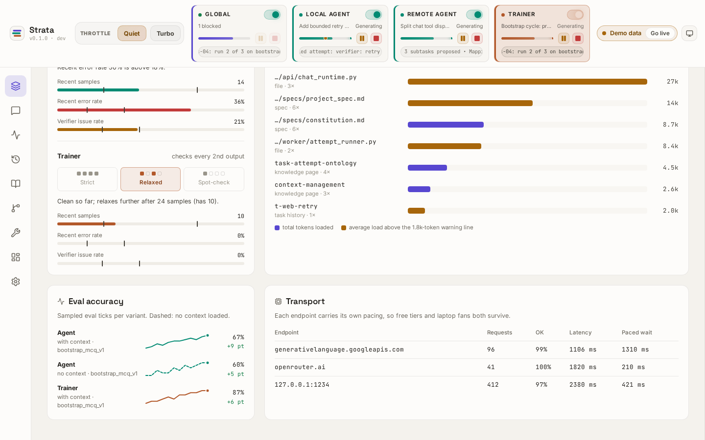
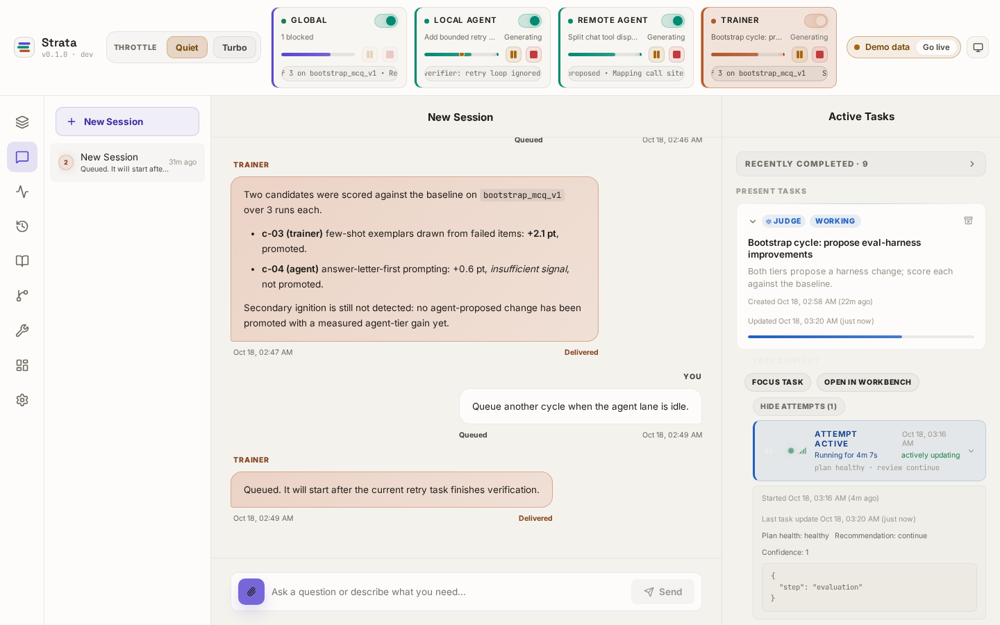
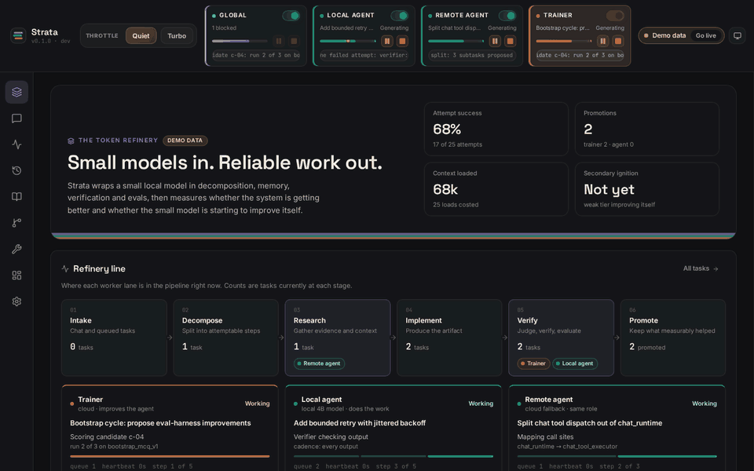
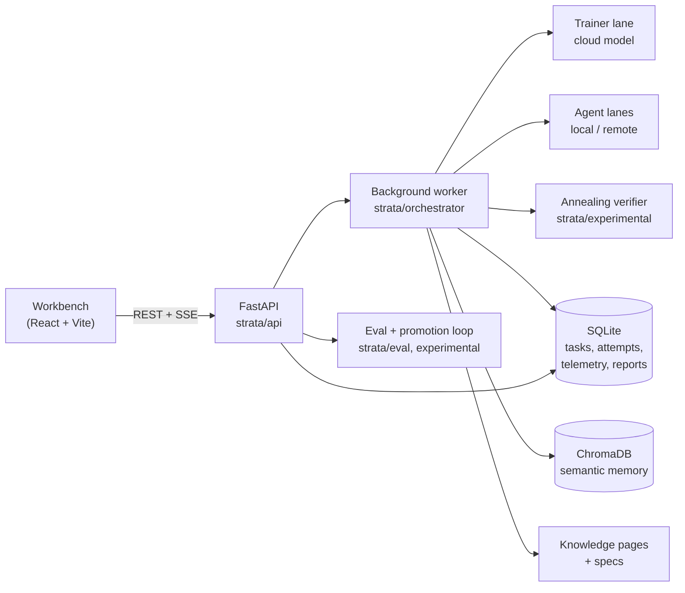

# Strata

> **The token refinery.** Small local models in, reliable work out.

Strata is a local-first agent harness built on one bet: a modest local model can do real work if the system around it supplies the rigor, memory, decomposition and verification the model lacks. Then it measures whether that's working, and whether the small model has started improving itself.



<p align="center">
  
  &nbsp;
  
</p>

*Screenshots show the workbench's built-in demo mode: a recorded sample run, labelled "Demo data" in the UI.*

## What it is

- **A FastAPI backend** with task, chat, session, admin and server-sent-event endpoints. State lives in SQLite; semantic memory in ChromaDB.
- **A background worker** that runs tasks through decomposition, research, implementation and judging. Every step is recorded as an *attempt* with an outcome, a reason and a resolution (reattempt, decompose, replan, abandon to parent, improve tooling, blocked).
- **Two model tiers, on purpose.** The **agent** (local-preferred, e.g. a 4B model in LM Studio or Ollama) helps the user and tries to improve itself. The **trainer** (cloud-preferred) improves the agent, and improves the agent's ability to improve itself.
- **A React workbench** (`strata_ui/`) for chat, live lanes, tasks and attempt history, a knowledge wiki, procedures, a debugger-style workbench, telemetry and settings.
- **An optional Tauri desktop shell** (`src-tauri/`) around the same UI and backend.

## Why it's interesting

The usual move is "use a bigger model." Strata moves the intelligence out of the model and into the system around it, then checks whether that worked.

- **It measures its own improvement.** A bootstrap cycle asks both tiers to propose changes to the eval harness, scores each candidate against the baseline over repeated runs, and promotes winners with a provenance record. A *secondary ignition* check asks the question that matters: has a change **proposed by the weak tier** been promoted **and** made the weak tier measurably better?
- **The verifier anneals.** Post-output verification checks every output while a lane has little evidence or a high error rate, then relaxes to every 2nd and every 4th output as clean evidence accumulates. Thresholds live in one table (`strata/experimental/verifier.py`), not in per-tier special cases.
- **Context is a scarce resource.** Every load of a spec, file, memory or task history into a prompt is costed in estimated tokens, and oversized artifacts are flagged before they become a quiet tax on a 4B model. Knowledge pages are read progressively (metadata, then section, then page) and filtered by audience, so agent-internal notes don't leak into user-facing answers.
- **Each endpoint paces itself.** Providers carry their own `requests_per_minute`, `max_concurrency` and adaptive intervals, so free tiers and laptop fans both survive.
- **Silence is a valid answer.** System-originated messages go through a routing layer that decides whether to speak, where, and in which thread, tracked through seen, delivered and read.
- **It has a constitution.** Durable rules live in a reviewable spec rather than buried in prompts. One of them sums up the project: *"Strata is a manual, not an automatic."* You can steer and inspect every part of it; you just shouldn't have to.

## Quickstart

### Demo mode: no backend, no model (about a minute)

Needs Node 20.19+ (or 22.12+).

```bash
git clone https://github.com/jon-vs-moloch/strata.git
cd strata
npm install --prefix strata_ui
npm run demo --prefix strata_ui
```

Open <http://localhost:5173>. The workbench replays a recorded sample run: lanes step through their tasks, and the eval loop, verifier and context-cost panels show real API responses recorded against a seeded database. Nothing is sent anywhere, and the UI says so. You can also add `?demo=1` to any URL, or use **View demo** in the top bar.

### Real mode: the full system

Needs Python 3.10+ and Node 20.19+. Tested with Python 3.12 and Node 22.

```bash
python3 -m venv venv
./venv/bin/pip install -r requirements.txt
PYTHONPATH=. ./venv/bin/python strata/api/main.py      # API on http://127.0.0.1:8000
```

In a second terminal:

```bash
npm install --prefix strata_ui
npm run dev --prefix strata_ui                          # workbench on http://localhost:5173
```

The API listens on `127.0.0.1:8000`. `STRATA_API_PORT` changes the port, and `VITE_STRATA_API` points the UI at a different address. The dev server stops if port 5173 is taken, rather than moving to a port the API would refuse; see **Security** below.

**Models.** The API starts without a model, but the worker won't run tasks until its local model is reachable. The default agent endpoint is LM Studio on `127.0.0.1:1234`; an Ollama preset on `127.0.0.1:11434` is included (`strata/models/registry.py`). Cloud trainer endpoints are optional and read keys from the environment: `CEREBRAS_API_KEY`, `GEMINI_API_KEY`, `OPENROUTER_API_KEY`.

### Security

The API has no user accounts or passwords. It exposes admin endpoints (reset, model registry, promote, reboot) and is meant to run on your own machine, for you alone.

Listening on `127.0.0.1` keeps other machines out. It does **not** keep out web pages open in your own browser, which can send requests to `127.0.0.1` too. So the API also checks every request (`strata/api/local_guard.py`):

- **Host.** The `Host` header must be `127.0.0.1`, `localhost` or `[::1]` on the API's port. This blocks DNS rebinding, where an attacker's domain is pointed at your machine.
- **Origin.** A request from a web page must come from the workbench itself. The allowed origins are the dev and demo server (`http://localhost:5173`, `http://127.0.0.1:5173`), `vite preview` (port 4173), the Tauri desktop shell, and the API's own address. Requests from any other site are refused, including plain form-style POSTs that CORS never checks. CORS allows only those origins, never `*`.
- **Write token.** Every POST, PUT, PATCH and DELETE needs an `X-Strata-Token` header. The API makes a new random token each time it starts. The workbench fetches it from `/admin/session-token`, which only the workbench origins can read. Local scripts read it from `strata/runtime/api-token` (readable only by your account) or from `STRATA_API_TOKEN`.

What this does **not** protect against:

- **Other programs running as you.** They can read the token file and call the API.
- **Other pages on an allowed origin.** If a different project's dev server runs on `localhost:5173`, its pages can call the API.
- **Exposing the port.** Keep `STRATA_API_HOST` on a loopback address, and don't put the API behind a proxy. A client on the network can send a loopback `Host` header itself, and GET endpoints need no token.
- **Reads in older browsers.** GET endpoints don't need the token. Browsers that label cross-site requests (`Origin` or `Sec-Fetch-Site`) have them refused; a browser that sends neither can still make a GET, but the page can't read the response.

If you serve the workbench from another origin, add it to `STRATA_UI_ORIGINS` (comma-separated, for example `http://localhost:5273`).

### Tests

Start the API once first (as in Real mode above); it creates the database tables some tests expect. Then run:

```bash
./venv/bin/python -m pytest tests
```

At this snapshot, with the API started first: **268 passed, 15 failed** of 283. On a fresh clone where the API has never run, the result is 265 passed and 18 failed, because those tables don't exist yet. One more test, `test_context_load_can_buffer_before_flush`, depends on timing and occasionally fails on a busy machine. The 15 failures below predate the snapshot and were left as found:

<details>
<summary>Known failing tests</summary>

| Test file | Failures | Cause |
|---|---|---|
| `test_specs_bootstrap.py` | 7 | Tests reference spec constants (`GLOBAL_SPEC_PATH`, `DEFAULT_GLOBAL_SPEC`) that the module no longer defines |
| `test_routing_policy.py` | 2 | Expect lane id `agent`; routing now returns the work pool `local_agent` |
| `test_context_telemetry.py` | 2 | Expect context loads on a passed-in storage session; the recorder now writes through its own isolated session |
| `test_research_module.py` | 2 | One hits a real `NameError` (`task_graph_context`) in the iteration-limit autopsy path; one expects an older error type |
| `test_operational_variants.py` | 2 | Fake model adapter returns a shape the implementation module no longer accepts |

</details>

### Regenerating the demo data

```bash
PYTHONPATH=. ./venv/bin/python scripts/build_demo_fixtures.py
```

This seeds a throwaway SQLite database with an invented sample run using Strata's own storage code, records what the real API returns for it, and writes `strata_ui/src/demo/recorded.json`. No model is called.

### More screens

| | |
|---|---|
|  |  |
| Candidates from both tiers, their measured effect and promotion decisions | Verifier cadence and thresholds, context cost per artifact, eval trends, provider pacing |
|  |  |
| Chat with a lane next to the live task rail and attempt history | A short tour in demo mode |

## Architecture



| Path | What lives there |
|---|---|
| `strata/api/` | App assembly (`main.py`) and route modules for chat, tasks, admin, evals, experiments, knowledge, specs |
| `strata/orchestrator/` | Worker, lanes, decomposition, research, implementation, judging, attempt runner and resolution policy |
| `strata/experimental/` | Experiment runner, promotion policy, variant ratings, calibration, trace review, annealing verifier |
| `strata/eval/` | Benchmarks, structured evals, eval jobs and the small bundled eval suite |
| `strata/observability/`, `strata/context/` | Context-load costing, host telemetry, pinned context files |
| `strata/knowledge/`, `.knowledge/specs/` | Audience-scoped knowledge pages; the constitution and project spec |
| `strata_ui/` | The workbench. `src/views/OverviewView.jsx` is the overview; `src/demo/` is demo mode |
| `docs/spec/` | Long-form design notes: philosophy, task/attempt ontology, communication model, codemap |

## Status

**Working prototype, paused.** Strata was built in a 12-day burst (March 23 to April 3, 2026) and runs end-to-end on a laptop. The eval-driven self-improvement loop exists and is instrumented; whether the weak tier reaches secondary ignition is exactly the open question it was built to answer. Expect rough edges, an evolving schema, and an operator workbench rather than a product.

This repository is a cleaned snapshot. The original 179-commit history is archived privately. The snapshot adds the overview, demo mode, the light/dark design system and a few fixes needed to run from a fresh clone.

The desktop shell (`src-tauri/`) is optional and was not rebuilt for this snapshot; its in-app updater stays inert unless you configure your own endpoint and signing key (see `docs/spec/desktop-distribution.md`).

## Licence

Apache-2.0. See [LICENSE](LICENSE) and [NOTICE](NOTICE).
